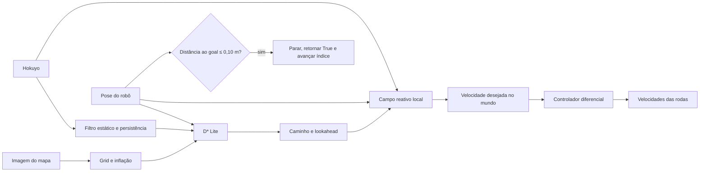
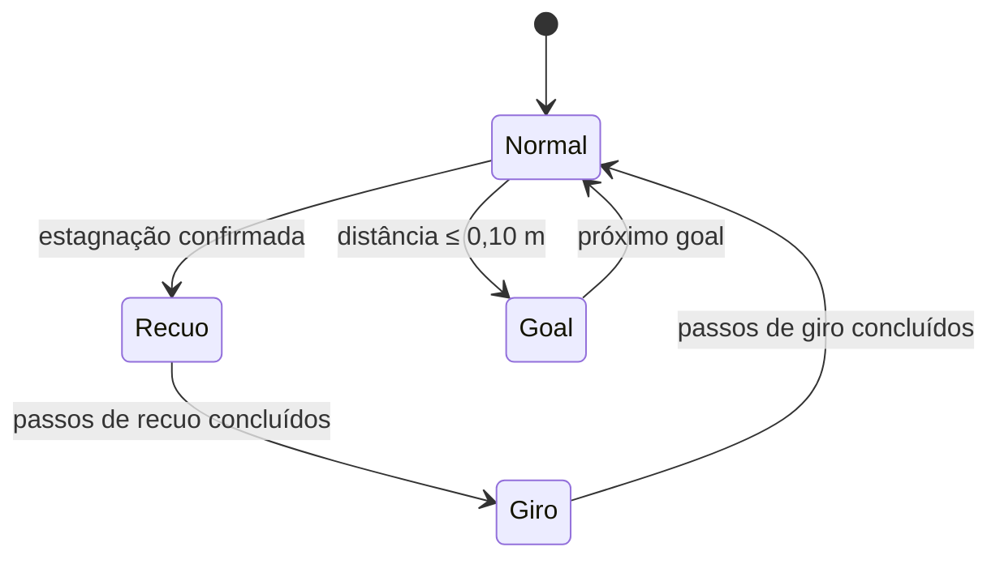
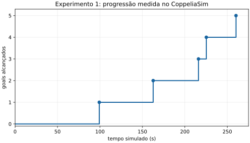
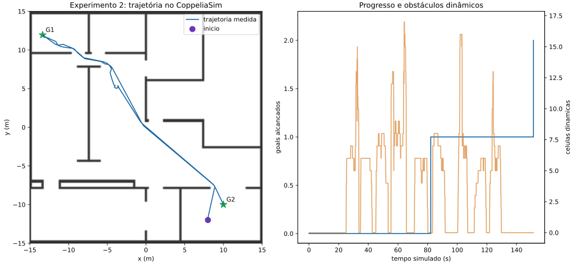
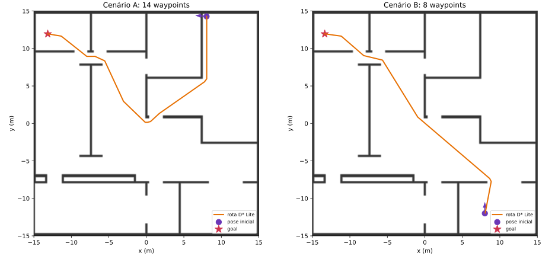
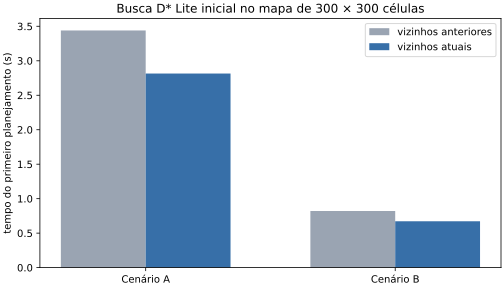

# TP2 — Planejamento e navegação

## 1. Introdução

O trabalho pede que um robô visite, em ordem, uma lista de pontos de interesse em um mapa conhecido. Na competição, outros robôs podem mudar os caminhos disponíveis e há limite de tempo. A solução recebe a imagem do mapa, a pose do robô e a lista de goals em cada ciclo. O código entregue ao servidor está em [`src/Agente1.py`](../src/Agente1.py), na classe `Agent`.

O projeto usa planejamento global D* Lite para paredes e obstáculos temporariamente inseridos no grid, com um controlador reativo local para obstáculos detectados pelo Hokuyo. A imagem do mapa representa 30 × 30 m. O grid tem células de 0,10 m, ou 300 × 300 células. As paredes são infladas pelo raio do robô (0,26 m) mais margem de 0,15 m.

## 2. Implementação

O `PlanejadorGlobal` converte pixels escuros em ocupação. Cada célula é bloqueada se contiver ao menos um pixel ocupado; a inflação impede planejar com o centro do robô sobre uma parede. O grafo é 8-conexo, com custo 1 nas arestas ortogonais e √2 nas diagonais. Uma diagonal é proibida quando cortaria o canto de células ocupadas. O estado incremental guarda `g`, `rhs`, uma fila de prioridade `U` e o ajuste heurístico `km`. Mudanças de ocupação atualizam os vértices afetados, sem recriar o planejador a cada ciclo. A rota final é encurtada por testes de linha de visada.

O `HokuyoSensorSim` entrega leituras `(ângulo, distância)` para o controle e, opcionalmente, pontos locais para as figuras. Transformações rígidas dos sensores fixos são calculadas uma vez. O `Sensoriamento` e o envio de comandos mantêm os handles dos objetos para evitar buscas remotas repetidas. Leituras coincidentes com paredes conhecidas são separadas das de objetos móveis. Leituras próximas de paredes ainda podem gerar reação de emergência.

A `CamadaReativa` combina atração para um ponto à frente da rota, repulsão radial, um termo tangencial para contornar objetos e um desvio à direita em encontros frontais. Uma leitura dinâmica só entra no grid após três ciclos de observação; desaparece após mais de quinze ciclos sem observação. As células bloqueadas são infladas e têm contagem de referência. A implementação guarda a área efetivamente adicionada por cada observação, de forma que a saída de um obstáculo não libere a área de outro quando o robô se move. O monitor de estagnação pode acionar recuo e giro.

O `Controlador` aplica a transformação de Desai usada no projeto: `v = cos(θ) vx + sin(θ) vy` e `ω = (−sin(θ) vx + cos(θ) vy)/d`, com `d = 0,20 m`. Depois converte `(v, ω)` em velocidades das duas rodas e limita velocidades altas. O `DetectorDeChegada` usa distância euclidiana e só permite `True` dentro de 0,10 m. Quando retorna `True`, as rodas recebem zero e o índice interno passa ao próximo goal. A rota seguinte é calculada no próximo ciclo, para que a confirmação de chegada não espere por outra busca global.

A interface pública é exatamente `Agent(id_robo)` e `movement(sim, img, goal_list)`, como exige o enunciado. A visualização opcional usa `habilitar_visualizacao()` ou `TP2_VISUALIZAR=1`, sem alterar essas assinaturas.

## 3. Testes e resultados

Os testes automatizados exercitam chegada, sequência de goals, laser, controle, replanejamento, inflação, obstáculos dinâmicos e recuperação. Execute `.venv/bin/python -m unittest discover -s tests -q`. Estes testes validam a lógica local; os dados de navegação abaixo foram obtidos no CoppeliaSim.

### Experimento 1 — sequência de cinco goals

Registro original: [`execucao_coppelia.ipynb`](../execucao_coppelia.ipynb). Pose inicial medida `(8,03; 14,28; 3,05 rad)`. Goals, na ordem: `(-13,15; 11,95)`, `(-13,35; -11,85)`, `(-0,35; 7,65)`, `(-3,55; 5,55)` e `(-11,35; 4,05)` m. A execução foi concluída com **5/5 goals em 260,25 s simulados**. Tempos acumulados de chegada, conforme a saída preservada no notebook: 99,20; 162,70; 216,05; 225,30; 260,25 s. Houve 370 passos em modo de recuperação e até 67 células dinâmicas bloqueadas ao mesmo tempo.

O percurso longo entre regiões distintas do mapa exigiu várias mudanças de direção. Todos os goals foram sinalizados como alcançados. A frequência de recuperação mostra que a execução terminou, mas ainda sofreu travamentos ou baixa progressão em alguns intervalos; isso é um ponto importante para otimização adicional. O notebook não mede colisões diretamente, por isso não se conclui ausência delas a partir desse registro.
Esta saída do notebook foi produzida antes das otimizações descritas abaixo e com visualização interativa. Os tempos dos dois experimentos têm configurações e números de goals diferentes, portanto não são uma comparação direta de desempenho.

### Experimento 2 — outra pose e orientação

Registro reproduzível: [`rodar_experimento_coppelia.py`](rodar_experimento_coppelia.py). Pose inicial solicitada `(8,00; −12,00; π/2 rad)`; goals `(-13,35; 11,95)` e `(10,00; −10,00)` m. O cenário atravessa o mapa duas vezes e inicia com orientação diferente da primeira execução.

O robô alcançou **2/2 goals em 151,40 s simulados**. G1 foi sinalizado em 82,05 s com erro de 0,078 m; G2, em 151,40 s com erro de 0,094 m. A distância percorrida pelas 3.030 amostras foi 70,68 m. Foram registrados 148 passos em recuperação e máximo de 17 células dinâmicas bloqueadas ao mesmo tempo. Ambos os erros ficam dentro da tolerância interna de 0,10 m. O segundo goal, a 0,094 m, está próximo desse limite; a aceitação final depende da regra do servidor.

O robô precisou voltar da região superior esquerda para a inferior direita e completou a sequência. A trajetória medida evidencia desvios em relação à linha direta. Como não foi instalado um contador de contato ou colisão, este registro não permite quantificar colisões. Após o teste, a simulação foi parada e a pose original do robô foi restaurada.

As amostras originais de cada passo estão em [`experimento_coppelia_2.csv`](experimento_coppelia_2.csv), e as métricas calculadas estão em [`experimento_coppelia_2.json`](experimento_coppelia_2.json). A figura mostra trajetória medida e progresso temporal. O erro de chegada corresponde à posição lida pelo script no instante em que `movement` retornou `True`.

### Avaliação offline de planejamento e desempenho

Dois pares de pose/goal no mapa fornecido foram planejados sem física, sensores nem outros robôs. Assim, esta seção mede somente a busca global e a geometria da rota; não substitui os dois experimentos anteriores no simulador. O script [`gerar_figuras.py`](gerar_figuras.py) recompõe os resultados. O cenário A usa a pose inicial e o primeiro goal do experimento 1. O B parte de `(8,00; −12,00; π/2)` para `(-13,35; 11,95)`.

A busca inicial foi medida duas vezes por variante, no mesmo processo, com `time.perf_counter`. A única diferença comparada é a enumeração dos vizinhos no D* Lite; as rotas foram conferidas ponto a ponto como idênticas. Medianas e amostras brutas ficam em [`metricas_offline.json`](metricas_offline.json).

| Cenário | Implementação anterior | Implementação atual | Redução da mediana | Waypoints |
| --- | ---: | ---: | ---: | ---: |
| A | 3,440 s | 2,815 s | 18,2% | 14 |
| B | 0,821 s | 0,672 s | 18,1% | 8 |

O ganho vem da geração dos vizinhos diretamente dentro dos limites da grade, sem validar milhões de tuplas intermediárias. Esses números são tempos de parede desta máquina, com apenas duas repetições; não são uma medida de tempo de competição. O custo de planejar o primeiro goal ainda é relevante. Para goals aleatórios de teste, o script agora percorre o componente livre uma vez e amostra goals conectados, evitando uma nova busca D* para cada candidato.

## 4. Conclusão e limites

A implementação visita goals sucessivos, confirma cada chegada com tolerância estrita e combina rotas globais com reação a obstáculos móveis. Os testes do simulador documentam poses iniciais e orientações distintas. A busca global ficou cerca de 18% mais rápida nos dois casos medidos, mantendo as mesmas rotas. O tempo inicial de planejamento, a necessidade de recuperação em alguns trechos e a ausência de medição automática de colisões são os principais limites observados. A validação oficial de pontuação ainda depende da tolerância e do protocolo exatos do servidor da competição.

## 5. Bibliografia

- Universidade Federal de Minas Gerais. *Trabalho Prático 2 — Planejamento e Navegação*. Enunciado fornecido em [`TP2.pdf`](../TP2.pdf), 2026.
- Koenig, S.; Likhachev, M. [*D* Lite*](https://aaai-25.aaai.org/Papers/AAAI/2002/AAAI02-072.pdf). *Proceedings of the 18th AAAI Conference on Artificial Intelligence*, 2002, pp. 476–483.
- Coppelia Robotics. [*CoppeliaSim Remote API overview*](https://manual.coppeliarobotics.com/en/remoteApiOverview.htm). Manual oficial, consultado em 2026.
- UFMG, Robótica Móvel. Material das Aulas 03 e 13 citado no enunciado para controle e visualização do mapa.
